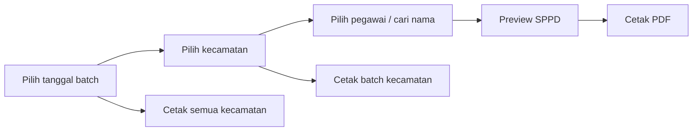

# Sistem Cetak SPPD — P3AP2KB Kabupaten Tanah Laut

Aplikasi web statis untuk menerbitkan dan mencetak **Surat Perintah Perjalanan Dinas (SPPD)** serta **SPPD KIE** Dinas P3AP2KB Kabupaten Tanah Laut. Tanpa framework, tanpa bundler, tanpa backend — cukup HTML, CSS, dan JavaScript.

Live: <https://sppd-dp3ap2kb.netlify.app/>

## Fitur

- Daftar 11 kecamatan dengan jumlah Kader IMP / Sub IMP per kecamatan.
- Rentang nomor SPPD per kecamatan pada kartu (mis. `01 – 37`), mengikuti tanggal batch terpilih.
- Daftar pegawai per kecamatan dalam bentuk grid, dengan pencarian nama dan penomoran SPPD berurutan.
- Preview SPPD 2 halaman (format cetak resmi) dan cetak PDF via dialog print browser.
- Cetak batch per kecamatan atau seluruh kecamatan, dengan pilihan halaman 1 saja, halaman 2 saja, atau keduanya.
- Tanggal perjalanan otomatis mengikuti hari kerja (Senin–Jumat); lama perjalanan dari jabatan.
- Penomoran per tanggal batch, tersinkron lewat Firebase Realtime Database dan di-cache di `localStorage`.
- Pengaturan admin: kelola tanggal batch, nomor awal, dan opsi "khusus Sub IMP".
- Chat ruang umum real-time (Firebase RTDB) dengan badge unread dan notifikasi judul tab.
- Dark mode, animasi masuk, dan pet kucing (neko) sebagai hiasan.

## Menjalankan

Aplikasi harus disajikan lewat HTTP karena memuat `settings.json` dan `kader_imp_sub_imp.json` dengan `fetch`.

```bash
# dari root folder project
python -m http.server 8000
# buka http://localhost:8000/index.html
```

Bisa juga lewat Laragon/Apache dengan root di `D:/laragon/www/spd_html`. Tidak ada build step, lint, typecheck, atau test otomatis — verifikasi dilakukan manual di browser.

## Alur Pakai



1. Pilih tanggal di dropdown **Tanggal** pada navbar (dari daftar tanggal batch).
2. Klik kartu kecamatan → daftar pegawai beserta nomor SPPD.
3. Klik pegawai (atau **Cetak SPPD**) → preview 2 halaman → `Ctrl+P` / **Cetak**.
4. **Cetak Semua Pegawai** mencetak seluruh pegawai kecamatan; **Cetak Semua Kecamatan** mencetak semua pegawai pada tanggal terpilih.

Pintasan: `/` fokus ke pencarian, `Esc` kembali, `Ctrl+P` mencetak saat preview terbuka.

## Struktur

| File | Isi |
| --- | --- |
| `index.html` | Halaman utama: navbar, grid kecamatan, daftar pegawai, preview SPPD 2 halaman, modal admin/update/nickname, panel chat, style & animasi inline. Elemen cetak ber-prefix `v-*`. |
| `cetak_kie.html` | Halaman cetak SPPD KIE mandiri (tab baru). Prefix `kie-*`, `@page size: legal`. |
| `app.js` | Semua logika: load data, penomoran, tanggal, render, preview/cetak batch, admin, `isiDataCetak()`. |
| `chat-ui.js` | Chat Firebase: listener `messages`, kirim/edit/hapus pesan, badge unread, status online. |
| `styles.css` | Design token di `:root`, dark mode, layout aplikasi, dan blok `PRINT STYLES` di bagian akhir. |
| `kader_imp_sub_imp.json` | Data master pegawai: `kader_IMP` dan `sub_IMP` per kecamatan. |
| `settings.json` | `nomorAwalSppd`, daftar `pejabat`, dan `kepalaAktif` untuk kolom VI halaman 2. |
| `neko/` | Pet kucing (anime.js), tidak ikut tercetak. |
| `.htaccess` | Blokir file sensitif dan directory listing (hanya berlaku di Apache). |

## Data

### `kader_imp_sub_imp.json`

```json
{
  "kader_IMP": [
    {
      "no": 1,
      "kecamatan": "PELAIHARI",
      "kader": [
        { "no_urut_kec": 1, "nama_kader": "Bahratul Asiah", "desa_kelurahan": "Pelaihari" }
      ]
    }
  ],
  "sub_IMP": [ ... ]
}
```

Saat ini berisi 135 Kader IMP dan 421 Sub IMP (total 556) pada 11 kecamatan. Tambah/perbarui pegawai di file ini, bukan di JS. Nama kecamatan dinormalisasi menjadi id (`BATI-BATI` → `bati_bati`).

### `settings.json`

```json
{
  "nomorAwalSppd": 1,
  "pejabat": [
    { "nama": "...", "nip": "...", "pangkat_gol": "...", "jabatan": "Kepala Dinas", "unit": "DP3AP2KB" }
  ],
  "kepalaAktif": "Sekretaris DP3AP2KB"
}
```

`kepalaAktif` harus sama dengan salah satu `pejabat.jabatan`; pejabat tersebut mengisi kolom VI halaman 2.

## Logika Penomoran & Tanggal

- Format nomor: `NN/DP3AP2KB/BULAN_ROMAWI/TAHUN`, mis. `01/DP3AP2KB/XI/2026`.
- Nomor dihitung ulang setiap tanggal batch dipilih, berurutan lintas kecamatan sesuai urutan `kecamatanList`, dimulai dari `nomorAwal` tanggal tersebut.
- Bulan & tahun mengikuti tanggal batch; override manual lewat input bulan (`v-input-bulan`) dihormati sampai tanggal diganti.
- Tanggal batch bertanda **Khusus Sub IMP** hanya menomori dan mencetak Sub IMP; Kader IMP tetap dihitung di ringkasan kecamatan.
- Tanggal perjalanan hanya hari kerja (Sabtu/Minggu dilewati) dan lama hari diambil dari jabatan: **Kader IMP = 4**, **Sub IMP = 3**, lainnya 1.
- Halaman 1 dan 2 disinkronkan oleh `updateTanggalKembali()` / `updateTanggalManual()` (`v-tgl-brkt2`, `v-tgl-kmbli2`, `formatTanggalRange`).

## Admin

Klik ikon gear di navbar → masukkan PIN (didefinisikan sebagai `ADMIN_PIN` di `app.js`). Menu ini untuk:

- melihat nomor awal SPPD dan kepala aktif;
- menambah/menghapus tanggal batch beserta nomor awal;
- menandai tanggal sebagai khusus Sub IMP;
- menampilkan/mengosongkan blok Kepala di kolom VI halaman 2 SPD (pilihan disimpan di `localStorage` per browser; tinggi sel tetap).

PIN ini gate tampilan di sisi klien, bukan otentikasi server.

## Firebase

Data yang dibagikan antar pengguna memakai Firebase Realtime Database:

| Path | Isi |
| --- | --- |
| `sppd/tanggalBatch` | Daftar `{ tanggal, nomorAwal, hanyaSub }` |
| `messages` | Pesan chat `{ nickname, message, color, timestamp }` |

Config Firebase ada di `chat-ui.js` (client-side, public by design). Aturan keamanan RTDB dikelola di Firebase Console, **tidak** ada di repo ini. `localStorage` menyimpan cache tanggal batch, nickname/warna chat, preferensi tema, dan data sementara `cetak_kie_data`.

## Cetak

- Ukuran kertas resmi: **legal**, margin 0 (`@page` di `styles.css` dan `cetak_kie.html`).
- Preview dan batch memakai `.page` yang sama; cetak batch meng-clone template halaman lalu mengisi tiap pegawai lewat `isiDataCetak(pegawai, 'v', wrapper)`.
- Kontrol layar (tombol, input tanggal, neko) disembunyikan saat print.
- **Jangan ubah** struktur tabel, kop surat, ukuran font, padding, atau `@page` tanpa memahami efeknya — perubahan kecil bisa menggeser halaman dan merusak format dinas.

## Deployment

Hosting statis apa pun (saat ini Netlify). Tidak ada build command; publish directory = root repo. `.htaccess` hanya relevan bila disajikan lewat Apache.

## Batasan yang Diketahui

- Nomor SPPD dan pengaturan admin tidak divalidasi server; semua data master ada di repo.
- PIN admin dan penanda "pesan milik sendiri" hanya ditegakkan di UI.
- Chat tidak memakai autentikasi; isi `messages` dapat dibaca/ditulis sesuai aturan RTDB di Firebase Console.
- Tombol **Cetak KIE** di daftar pegawai sengaja disembunyikan (`display:none`).
